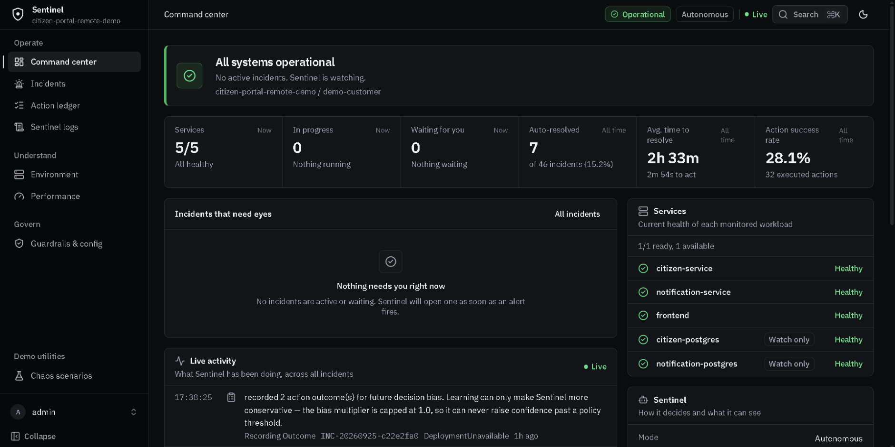
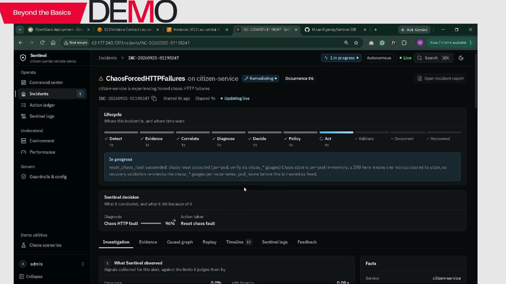
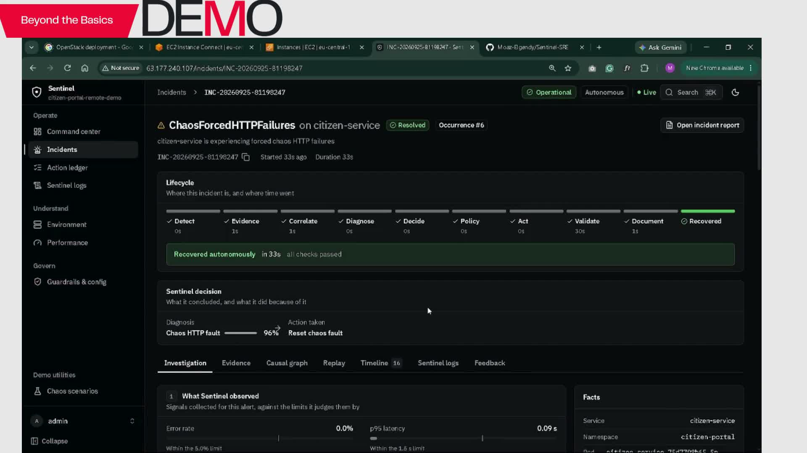
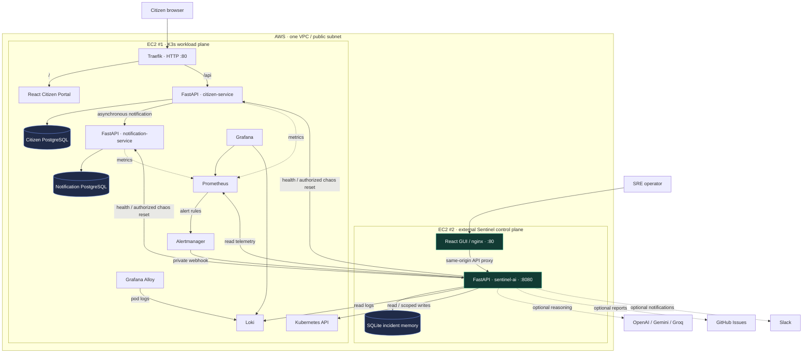
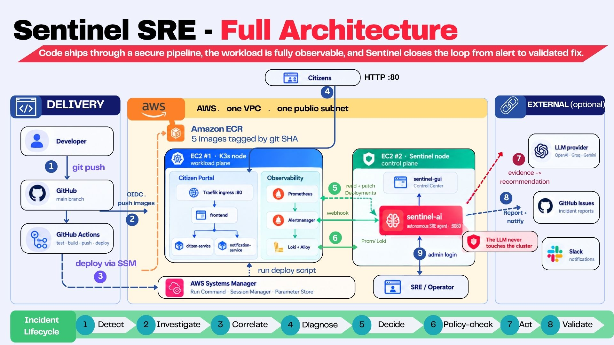
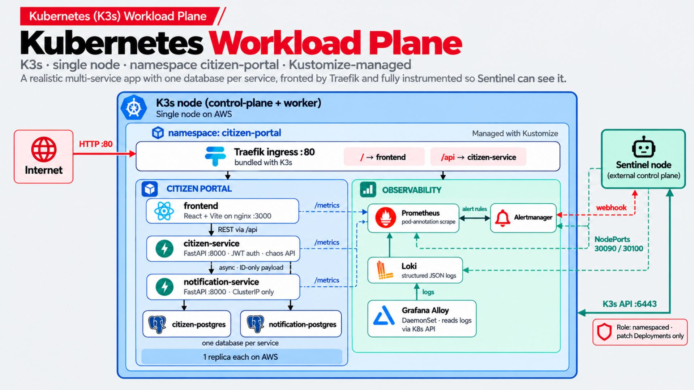
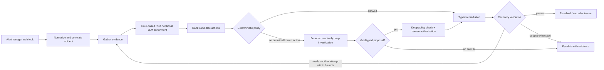
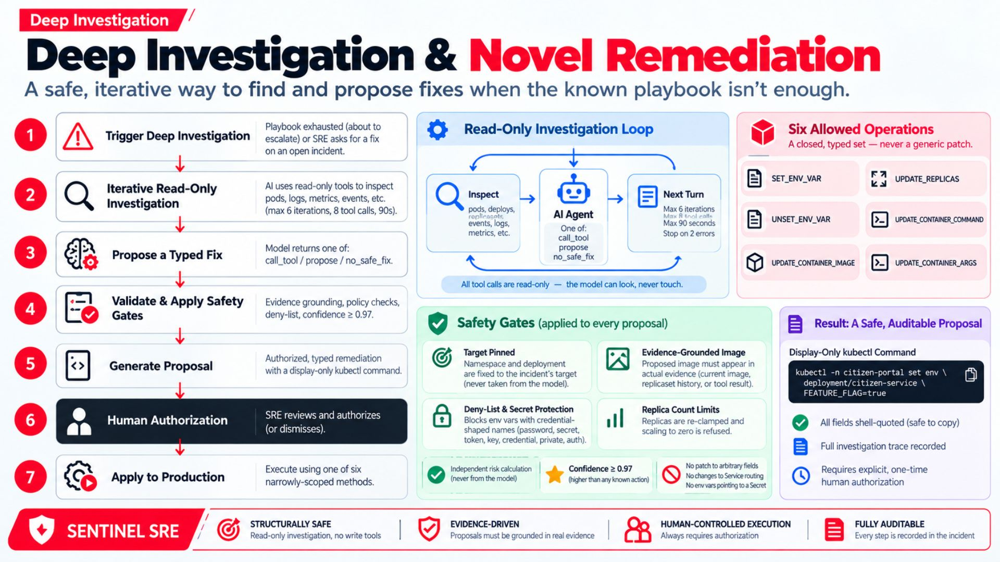
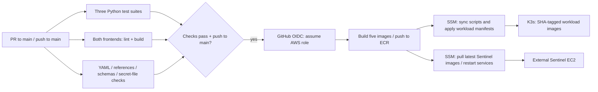
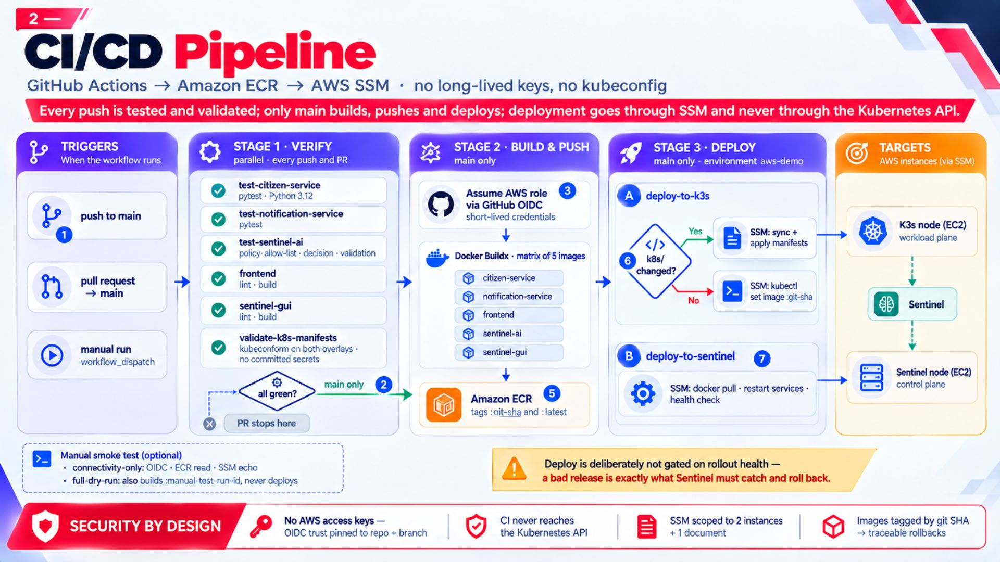

# Sentinel SRE

### From alert to evidence, policy-checked action, and verified recovery.

Sentinel addresses the slow, manual work between a Kubernetes alert and a verified recovery. It gathers telemetry and cluster evidence, evaluates bounded remediation options, and records what happened.

| Reviewer question | Answer from this repository |
|---|---|
| **What problem does it solve?** | Turns incident response into an evidence-backed, policy-gated lifecycle with recovery validation. |
| **What has run?** | The supplied AWS demo recording shows Sentinel handling an HTTP chaos incident through reset and validated recovery; the owner reports the AWS demo was deployed and working. |
| **How can I verify it?** | [Watch the demo](docs/media/sentinel-demo.mp4), inspect its [evidence frames](docs/README-EVIDENCE.md), then trace behavior in the [workflow](.github/workflows/ci-cd.yml), [policy](sentinel-ai/app/lifecycle/policy.py), and [validator](sentinel-ai/app/lifecycle/validation.py). |
| **What engineering choices matter?** | Optional LLM reasoning; deterministic allow-lists and thresholds; typed Kubernetes writes; deep proposals require human authorization; Sentinel runs outside the workload cluster. |

**The model advises. Policy authorizes. Typed executors act. Recovery checks decide whether it worked.**

[Architecture](#architecture) · [Safety gates](#safety-gates) · [Run locally](#run-locally) · [AWS & delivery](#aws-deployment-and-cicd) · [Demo](#see-it-work) · [Scope & roadmap](#implemented-scope-and-roadmap)



*Actual project GUI. Dashboard counts and rates describe this demo's recorded history; they are not reliability benchmarks.*

## Why this project exists

An alert tells an operator something is wrong. It does not establish the cause, identify a safe response, or prove recovery. Sentinel connects those steps into one auditable incident lifecycle.

The monitored workload is a Citizen Portal: a React frontend, two FastAPI services, and a separate PostgreSQL database for each service. Deliberate failures make the system observable under stress, while Sentinel runs on a separate EC2 instance so its control plane remains independent of the application cluster.

- **Evidence first:** Prometheus metrics, Loki logs, Kubernetes state/events, health probes, and optional GitHub deployment correlation.
- **Bounded autonomy:** restart, rollback, scale, or reset an injected chaos fault, subject to allow-lists, confidence thresholds, cooldowns, and action-specific checks.
- **A second path for unfamiliar failures:** bounded, read-only deep investigation produces a typed proposal that always requires explicit human authorization.
- **A visible audit trail:** incident evidence, causal views, policy decisions, actions, validation, replay, feedback, and persisted activity in the operator GUI.

## See it work

[**Watch the supplied 66-second demonstration →**](docs/media/sentinel-demo.mp4)

The recording shows an HTTP chaos incident on `citizen-service`, a `reset_chaos_fault` response, and a subsequent resolved incident. These frames come directly from that recording:

| Policy-approved remediation in progress (~00:30) | Incident resolved (~00:55) |
|---|---|
|  |  |

The project owner reports that the application was deployed and working on AWS. The supplied recording shows the remote GUI and AWS browser tabs; the repository contains the corresponding Terraform, K3s configuration, and delivery workflow. This README does not assert that a historical demo address is still online, or that every scenario succeeded. See the [evidence guide](docs/README-EVIDENCE.md) for provenance and presentation caveats.

## Architecture



This diagram follows the active AWS overlay and external-instance bootstrap, rather than older comments describing an in-cluster Sentinel. The GUI and agent run as Docker containers managed by systemd on the Sentinel instance. PostgreSQL and monitoring remain inside K3s; this is **K3s on EC2, not EKS**.

| Component | Responsibility | Source |
|---|---|---|
| Citizen Portal | Registration/login, service catalog, requests, profile, uploads | [`frontend/`](frontend/), [`citizen-service/`](citizen-service/) |
| Notification service | Independent API and database; downstream notification processing | [`notification-service/`](notification-service/) |
| Observability | Metrics, alert routing, log collection, dashboards | [`k8s/base/monitoring/`](k8s/base/monitoring/) |
| Sentinel engine | Evidence → correlation → diagnosis → decision → policy → execution → validation | [`sentinel-ai/app/lifecycle/`](sentinel-ai/app/lifecycle/) |
| Operator console | Incidents, action ledger, live logs, environment, performance, guardrails, chaos controls | [`sentinel-gui/`](sentinel-gui/) |
| Infrastructure | VPC, EC2/EBS, IAM, ECR, SSM, external control plane | [`infra/terraform/`](infra/terraform/) |

<details>
<summary>Presentation architecture and workload diagrams</summary>





These are original presentation assets. The source-based diagram and scope notes in this README take precedence where a slide simplifies implementation details.

</details>

## Incident lifecycle



Repeated alerts are correlated by environment, application, namespace, service, and failure class. They update an existing live incident rather than starting duplicate remediation. A per-deployment lock serializes writes; stale evidence is re-investigated after another incident acts. Terminal incidents, recurrence gaps, and material-evidence checks bound reopening. See the [incident engine notes](docs/incident-engine.md).

Recovery validation checks deployment availability, pod readiness/crash loops, parsed health status, error rate, p95 latency, CPU/memory, and relevant per-pod chaos gauges. A successful patch or HTTP response alone is insufficient. The validator can recognize a substantially recovering error rate while a five-minute metric window still contains pre-fix errors; its report records that distinction.

## Safety gates

### Known actions: autonomous only when policy permits

| Action | Default confidence requirement | Additional boundary |
|---|---:|---|
| Roll back deployment | 0.95 | Requires deployment history, a previous revision, correlation with recent deployment, reversibility, and available recovery validation |
| Restart deployment | 0.90 | Must pass target, statefulness, rate-limit, and action-specific checks |
| Scale deployment | 0.90 | Default permitted replica range is 1–3; zero replicas is refused |
| Reset chaos fault | 0.90 | Requires the configured chaos surface and token |

The [policy engine](sentinel-ai/app/lifecycle/policy.py) denies by default. The [executor](sentinel-ai/app/lifecycle/remediation.py) requires an allowed verdict and independently rechecks its target.

- Default allowed namespace: `citizen-portal`; deployments: `citizen-service`, `notification-service`, `frontend`.
- Frozen deny-lists protect `citizen-postgres`, `notification-postgres`, and Kubernetes system namespaces. Stateful targets are also excluded.
- Defaults: at most **3 actions per incident**, **120 seconds** between actions, **5 lifecycle cycles**, **4 concurrent lifecycles**, and a **1,800-second** run budget checked between cycles.
- `DRY_RUN` defaults to **`false`** in source. Set **`DRY_RUN=true`** when first connecting a new environment and inspect decisions before enabling writes.
- Temporary human authorization for a known action may substitute for its confidence requirement; it does **not** bypass target restrictions, cooldowns, caps, or action preconditions.

Confidence scores are internal decision signals, not calibrated probabilities of success. Defaults are configurable; the live guardrail configuration is authoritative.

### Deep investigation: read-only reasoning, human-authorized execution

When the known playbook is exhausted, or an operator selects **Suggest Fix**, Sentinel can perform an iterative evidence investigation. Default limits are **6 turns**, **8 tool calls**, and **90 seconds**, with bounded responses and error limits.

The result must be one of six typed operations:

`SET_ENV_VAR` · `UNSET_ENV_VAR` · `UPDATE_CONTAINER_IMAGE` · `UPDATE_REPLICAS` · `UPDATE_CONTAINER_COMMAND` · `UPDATE_CONTAINER_ARGS`

The target is pinned to the incident. Credential-shaped environment keys are blocked, proposed images must be grounded in deployment evidence/history, and replicas are constrained. Proposals must clear the default **0.97** threshold and deep policy checks, then receive explicit, one-time human authorization. Risk is computed by code rather than accepted from the model.

There is no generic manifest-patch or free-form shell execution interface. Displayed `kubectl` commands are explanatory; execution uses typed client methods. Command/argument changes can still alter application behavior and deserve careful operator review.

<details>
<summary>Original deep-investigation presentation slide</summary>



</details>

### Memory and replay

SQLite persists incidents, evidence, policy decisions, authorizations, and action outcomes. Outcome learning applies a bounded success-ratio bias: it can reduce confidence or reorder candidates, but cannot raise confidence above its original value or invent new actions. This is **not model training**.

Replay evaluates stored evidence through the decision/policy pipeline without live investigation or remediation. It supports reviewing “what would Sentinel decide?” without changing the cluster.

## Run locally

Commands below are checked against the uploaded source and are run from the repository root unless stated otherwise. They were not executed against Docker, Kubernetes, or AWS during this documentation rewrite. Bash examples require Bash; on Windows use WSL or Git Bash as appropriate.

### 1. Citizen Portal with Docker Compose

Prerequisites: Docker with Compose support and available ports 3000, 8000, 8001, 5432, and 5433.

```bash
cp .env.example .env
# Edit .env: replace database passwords, JWT_SECRET, and CHAOS_ADMIN_TOKEN.
docker compose up --build
```

| Local address | Purpose |
|---|---|
| `http://localhost:3000` | Citizen Portal |
| `http://localhost:8000/docs` | Citizen API documentation |
| `http://localhost:8001/docs` | Notification API documentation |

Compose starts the portal, two APIs, and two databases. API startup runs migrations; the citizen service also seeds the catalog. **It does not start Sentinel or the monitoring stack.** Keep `CHAOS_MODE=false` for normal portal use. Browser-facing API URLs are baked in at frontend build time; rebuild after changing `FRONTEND_API_BASE_URL`.

### 2. Local Kubernetes workload and observability

For a local demo, choose the script matching your installed cluster tooling:

```bash
bash scripts/deploy-kind.sh
# Alternatives: bash scripts/deploy-minikube.sh
#               bash scripts/deploy-docker-desktop.sh
```

The scripts build/load application images, apply the local Kustomize overlay, wait for workloads, and print access instructions. The local overlay contains committed demo credentials; keep it confined to local experimentation. These scripts deploy the application and monitoring, **not an external Sentinel control plane**. Follow [`k8s/README.md`](k8s/README.md) for access details and [`docs/sentinel-remote-validation-runbook.md`](docs/sentinel-remote-validation-runbook.md) for connecting Sentinel.

### 3. Configure and run the Sentinel API

Use a separate Python 3.12 environment for `sentinel-ai/` and install its pinned dependencies:

```bash
cd sentinel-ai
python -m venv .venv
source .venv/bin/activate
python -m pip install -r requirements.txt
```

Create `sentinel-ai/.env` with values appropriate to your environment. [Settings](sentinel-ai/app/core/config.py) and the [AWS environment example](k8s/overlays/aws/secrets/sentinel.env.example) document the supported names. Configure at least:

| Setting | Purpose |
|---|---|
| `DRY_RUN=true` | Inspect proposed operations before enabling mutations |
| `SENTINEL_DB_PATH` | Writable SQLite path; use `./sentinel.db` for a local run |
| `SENTINEL_ADMIN_USERNAME`, `SENTINEL_ADMIN_PASSWORD`, `SENTINEL_JWT_SECRET` | Operator login and persistent session signing |
| `KUBERNETES_MODE` | `in_cluster`, `kubeconfig`, or `remote` |
| `KUBERNETES_KUBECONFIG_B64` | Base64 kubeconfig for `kubeconfig` mode |
| `KUBERNETES_API_SERVER`, `KUBERNETES_TOKEN`, `KUBERNETES_CA_CERT_B64` | Remote-mode connection and trust configuration |
| `PROMETHEUS_URL`, `LOKI_URL`, `ALERTMANAGER_URL` | Addresses reachable from the Sentinel process |
| `CITIZEN_SERVICE_URL`, `NOTIFICATION_SERVICE_URL`, `FRONTEND_URL` | Reachable application addresses for health/evidence checks |
| `CHAOS_ADMIN_TOKEN` | Must match the services when using chaos reset |

Local cluster DNS names such as `http://prometheus:9090` do not resolve automatically from an external process. Configure reachable endpoints and namespace-scoped Kubernetes credentials using the remote runbook.

Optional integrations: `LLM_PROVIDER=openai|gemini|groq` with the corresponding API key/model settings; `GITHUB_TOKEN` + `GITHUB_REPOSITORY`; `SLACK_WEBHOOK_URL`. Without a reasoning-provider key, the standard incident path uses rule-based RCA. Deep LLM investigation requires a configured reasoner.

```bash
# Still inside sentinel-ai/, with the environment configured:
uvicorn app.main:app --host 127.0.0.1 --port 8080
```

`GET /healthz` checks process liveness. `GET /readyz` checks the store and Kubernetes connection and reports the live execution mode. A running API alone does not prove connector readiness.

### 4. Start the operator GUI

In another terminal, use the repository's frontend toolchain (CI specifies Node 20; installed packages must also satisfy their own engine requirements):

```bash
cd sentinel-gui
cp .env.example .env
npm ci
npm run dev
```

The example points the browser at `http://localhost:8080`; Vite serves the GUI on `http://localhost:5173`. Sign in with the Sentinel admin credentials configured above. The deployed nginx build instead uses same-origin API calls. Citizen Portal and Sentinel operator logins are separate identity systems.

Configure Alertmanager to deliver to **`POST /api/alerts/webhook`** on a Sentinel address reachable from the cluster. Starting the GUI does not configure alert delivery. See the remote validation runbook for end-to-end wiring.

## AWS deployment and CI/CD

The implementation provisions a single-node K3s workload instance and, with `enable_remote_sentinel=true` (the current variable default), a separate Sentinel instance. Current Terraform defaults include region `eu-central-1`, workload type `m7i-flex.large`, Sentinel type `t3.small`, and a 40 GiB workload root volume. Override these for your account; older examples contain different defaults.

Kubernetes API, telemetry NodePorts, and application chaos NodePorts are restricted to the Sentinel security group. Alertmanager reaches Sentinel's port 8080 from the workload security group. The portal and GUI expose HTTP port 80 according to `allowed_http_cidrs`. SSM provides administration without opening SSH.

Deployment references:

1. [`infra/terraform/terraform.tfvars.example`](infra/terraform/terraform.tfvars.example) — account/repository-specific configuration.
2. [`docs/aws-deployment.md`](docs/aws-deployment.md) — infrastructure and initial workload deployment.
3. [`docs/sentinel-remote-validation-runbook.md`](docs/sentinel-remote-validation-runbook.md) — remote API access, RBAC, token/CA parameters, and validation.
4. [`scripts/generate-aws-secrets.sh`](scripts/generate-aws-secrets.sh) and [`scripts/deploy-aws.sh`](scripts/deploy-aws.sh) — first workload deployment on the EC2 node.

**Read the [source review notes](docs/README-SOURCE-REVIEW.md) before following historical runbooks.** Their old “never deployed” status text, in-cluster topology descriptions, and some defaults no longer agree with the supplied demonstration or current executable configuration. Do not apply the AWS overlay directly with unresolved image, public-IP, or Sentinel-upstream placeholders.



The executable [GitHub Actions workflow](.github/workflows/ci-cd.yml) is authoritative:

- PRs to `main` and pushes to `main` run backend tests, both frontend checks, and Kubernetes manifest validation. PRs do not deploy.
- Successful pushes build **five images**: `citizen-service`, `notification-service`, `frontend`, `sentinel-ai`, and `sentinel-gui`, tagged with the commit SHA and `latest`.
- AWS authentication uses GitHub OIDC rather than stored AWS access keys. Deployment runs through SSM; GitHub runners do not need a kubeconfig or direct Kubernetes API access.
- The K3s job refreshes deployment scripts, syncs changed manifests, discovers the external Sentinel private IP, and applies rendered manifests even for code-only deployments. Workload image tags use the commit SHA.
- The external Sentinel job currently pulls **`latest`** from the hardcoded `sentinel-sre-demo` ECR prefix, restarts both systemd services, and checks that they are active. This does not establish application readiness or SHA-pinned deployment.
- Workload deployment deliberately does **not** wait for healthy rollout: bad releases are part of the remediation demonstration.
- Manual `workflow_dispatch` offers `connectivity-only` (OIDC/ECR/SSM check) or `full-dry-run` (also builds/pushes `manual-test-<run_id>` images). Neither manual mode deploys.

Configure the `aws-demo` GitHub Environment and the workflow's required values: variables `AWS_REGION`, `ECR_REPOSITORY_PREFIX`; secrets `AWS_ROLE_TO_ASSUME`, `EC2_INSTANCE_ID`, `SENTINEL_EC2_INSTANCE_ID`. Repository/branch/environment trust must match the Terraform OIDC policy. Environment protection rules depend on repository settings; their presence is not proven by the YAML alone.

<details>
<summary>Original CI/CD presentation slide</summary>



The slide summarizes delivery intent. In the current workflow, the K3s job always applies rendered manifests, and the external Sentinel job uses `latest` and systemd active-state checks.

</details>

## Exercise the system

The [smoke test](scripts/smoke-test.sh) registers a test citizen, logs in, browses services, submits a request, and checks downstream notification behavior:

```bash
bash scripts/smoke-test.sh http://localhost:8000
```

For a configured Kubernetes **demo environment**, the incident harness supports:

| Application faults | Platform / release faults |
|---|---|
| `db-outage`, `http-errors`, `latency`, `notification-degradation`, `high-cpu`, `memory-leak` | `full-outage`, `crashloop`, `bad-deployment` |

It requires a valid `kubectl` context, monitoring, chaos-enabled services, and the matching token in `CHAOS_ADMIN_TOKEN`.

```bash
# Injects an actual fault into the selected demo cluster:
bash scripts/incident-scenarios.sh http-errors citizen-portal
```

Watch the GUI for evidence collection, candidate selection, the policy verdict, execution, and recovery validation. A correct result can be escalation: database deployments remain watch-only. The `bad-deployment` scenario intentionally leaves a broken release for Sentinel to handle; inspect that scenario's recovery options before running it. A “scenario exists” claim is not a claim that every scenario has been demonstrated successfully.

### Verification commands

Run each Python suite from its service directory after installing that service's `requirements.txt` in a separate environment:

```bash
python -m pytest -v
```

Citizen tests require `DATABASE_PASSWORD`, `JWT_SECRET`, and `CHAOS_ADMIN_TOKEN`; notification tests require `DATABASE_PASSWORD` and `CHAOS_ADMIN_TOKEN`. CI uses nonempty test values and SQLite-backed fixtures. Sentinel tests inject fake connectors for the critical decision, policy, authorization, remediation, and recovery paths.

For each frontend, from `frontend/` or `sentinel-gui/`:

```bash
npm ci
npm run lint
npm run build
```

No current test-pass count, CI badge, coverage percentage, or fresh AWS validation is asserted here.

## Implemented scope and roadmap

| Area | Implemented in this source | Remaining work / boundary |
|---|---|---|
| Kubernetes response | Scoped restart/rollback/scale, chaos reset, typed deep proposals | Broader autonomous actions require new explicit policies and executors |
| Environment support | Persisted environment records, connection testing, namespace discovery | **One active environment per process**; registration replaces the active context, with no multi-environment alert routing |
| Investigation | Rules, optional provider enrichment, bounded read-only deep investigation | No standalone trained Sentinel model |
| Learning | Recorded outcomes and conservative candidate bias | No fine-tuning or self-expanding permissions |
| AWS | Terraform deployment, ECR/SSM/OIDC delivery; EC2/CloudWatch client exists | AWS client is not wired into incident evidence collection |
| Concurrency | Async incident tasks and per-deployment locking | In-process leases and SQLite assume one Sentinel replica; distributed coordination is not implemented |
| Deployment | AWS demo with external control plane | Pin external Sentinel deploys to SHA and verify API readiness; reconcile hardcoded ECR prefix and older runbooks |
| Production operations | Demo persistence, scoped networking, operator authentication | Multi-AZ/HA, managed database backups and restore tests, TLS, remote Terraform state, credential rotation, and hardened ingress remain work |

The demonstration uses a single workload node, local-disk PostgreSQL, and HTTP entrypoints. It establishes a working prototype, not production availability, security certification, or suitability for real citizen data.

## Repository map

```text
citizen-service/       Citizen API, migrations, seed data, tests
notification-service/ Notification API, independent migrations and tests
frontend/             Citizen Portal React application
sentinel-ai/          Incident engine, connectors, policy, persistence, tests
sentinel-gui/         Operator console and nginx API proxy
k8s/base/             Shared application and monitoring manifests
k8s/overlays/         Local and AWS configurations
infra/terraform/      AWS infrastructure and bootstrap templates
scripts/              Deploy helpers, smoke test, incident harness
docs/                 Runbooks, engine documentation, visual evidence
.github/workflows/    CI, image publishing, and SSM deployments
```

Explore the [visual evidence guide](docs/README-EVIDENCE.md), [source review notes](docs/README-SOURCE-REVIEW.md), [integration notes](docs/sentinel-integration.md), and [development history](Phases.md) for detail. Historical reports describe earlier checkpoints; current executable source and the scope table above define this README's claims.

